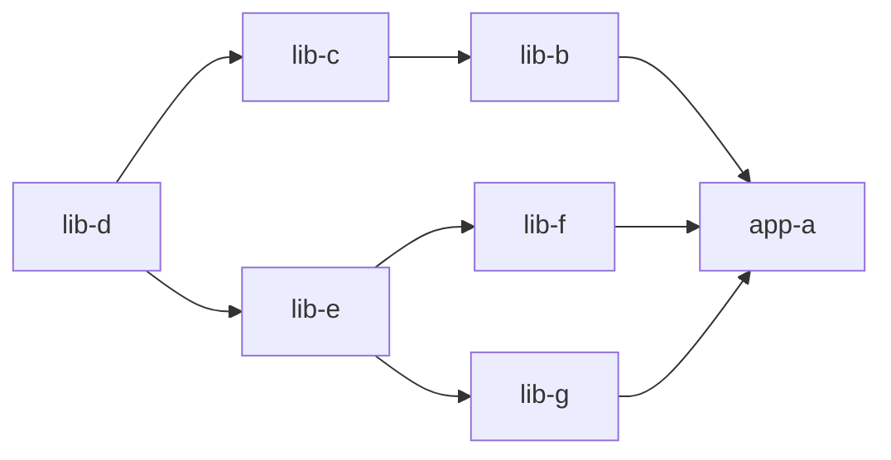
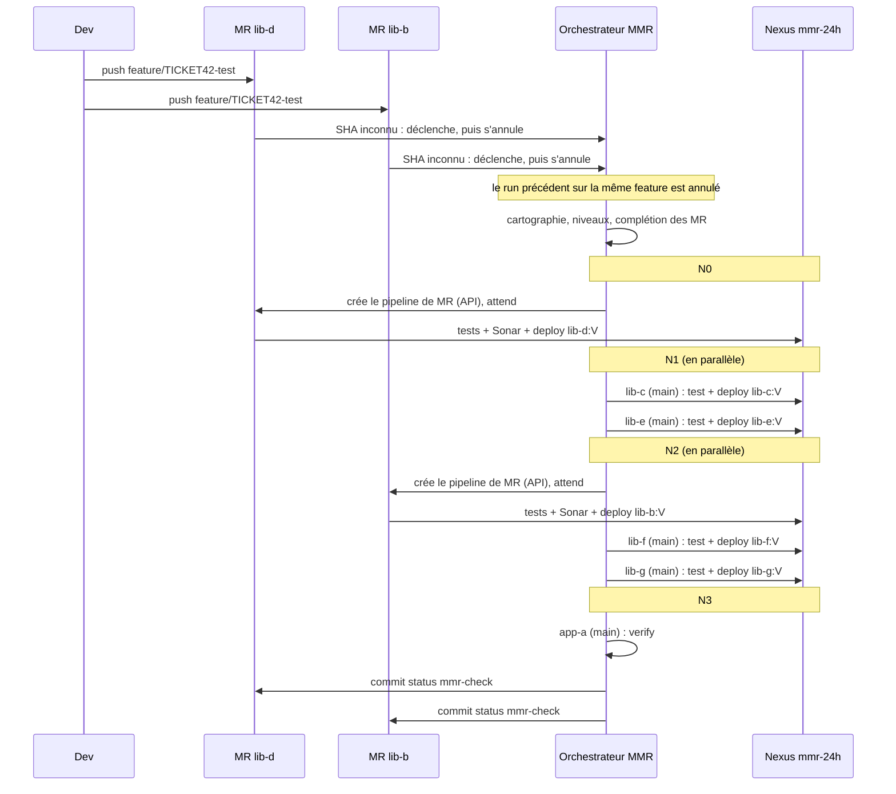
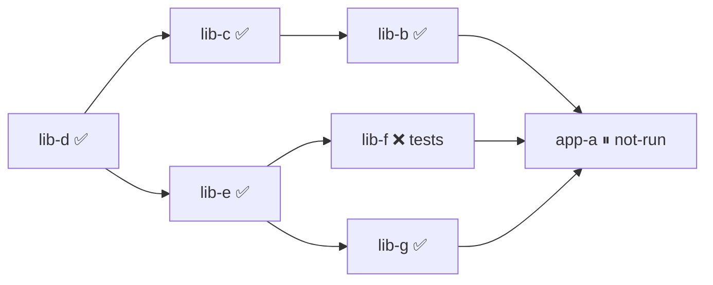

# MMR workflow : vérification multi-repo par Multi Merge Request

## Objectif

Quand un développeur modifie un composant (une lib), vérifier automatiquement toute la **chaîne d'impact** : les composants qui en dépendent, directement ou transitivement, doivent toujours compiler et passer leurs tests.

Le workflow gère aussi :
- une même évolution qui touche **plusieurs repos** en même temps ;
- un graphe d'impact qui se **ramifie** (plusieurs chemins depuis la lib modifiée) ;
- la **casse d'un composant impacté** : le workflow ouvre une branche et une MR sur ce composant, prévient le développeur, et s'arrête.

Chaque MR garde ses vrais résultats de qualité (tests, Sonar).

## Exemple utilisé dans ce document



(`A --> B` signifie « B dépend de A ».)

lib-d a deux chemins de consommateurs :
- une branche **c → b**, linéaire ;
- une branche **e → f / g**, qui se ramifie elle-même.

Les trois chemins se rejoignent dans app-a, qui tire donc lib-d par plusieurs chemins (diamant).

Le développeur crée la branche `feature/TICKET42-test` et ouvre une MR sur **lib-d** et sur **lib-b**.

| Composant | Rôle | Traitement |
|---|---|---|
| lib-d | modifié (branche + MR) | pipeline de MR réel : tests, Sonar, deploy MMR |
| lib-c | impacté | build local par l'orchestrateur depuis main : tests, deploy MMR |
| lib-e | impacté | build local : tests, deploy MMR |
| lib-b | modifié (branche + MR) | pipeline de MR réel : tests, Sonar, deploy MMR |
| lib-f | impacté | build local : tests, deploy MMR |
| lib-g | impacté | build local : tests, deploy MMR |
| app-a | impacté (feuille) | build local : `verify` seulement, pas de deploy |

### Niveaux du tri topologique

Les composants d'un même niveau sont indépendants entre eux et peuvent être buildés **en parallèle**.

| Niveau | Composants | Dépend de |
|---|---|---|
| N0 | lib-d | |
| N1 | lib-c, lib-e | lib-d |
| N2 | lib-b, lib-f, lib-g | lib-c (pour lib-b), lib-e (pour lib-f et lib-g) |
| N3 | app-a | lib-b, lib-f, lib-g |

La durée totale dépend de la profondeur du graphe (4 niveaux), pas du nombre de composants (7).

## Prérequis côté Maven

- Version des projets : `${revision}`, qui vaut `999-SNAPSHOT` par défaut, avec flatten-maven-plugin.
- Chaque dépendance interne est référencée par une propriété `<artifactId>.version` (ex. `lib-c.version`), qui vaut `999-SNAPSHOT` par défaut.
- Le parent commun des applications déclare ces propriétés dans un `dependencyManagement`, pour que la surcharge s'applique aussi aux dépendances transitives et aux diamants (cas d'app-a).
- La version du parent n'utilise **pas** `${revision}` : sinon, surcharger `revision` casse la résolution du parent.

## Principes

### 1. Une version déterministe par feature

N'importe quel job peut la recalculer à partir du nom de branche, sans qu'on ait à la lui transmettre :

```
feature/TICKET42-test  ->  V = 0.0.0-mmr-TICKET42-test-SNAPSHOT
```

Le nom de feature est nettoyé (tout caractère hors `[A-Za-z0-9._-]` devient `-`).

### 2. Un repo Nexus dédié avec 24h de rétention

- Repo Maven `mmr-24h` (snapshots), dans lequel on déploie avec `-DaltDeploymentRepository=mmr::<url>`.
- Ce repo est ajouté au groupe Nexus utilisé comme mirror par la CI, pour que les builds suivants puissent lire les artefacts V.
- Une tâche de cleanup planifiée applique réellement la rétention.
- Les versions V sont propres à une feature : aucune collision possible avec les vraies versions.

### 3. Un manifeste par feature

Il est écrit par l'orchestrateur et lu par les pipelines de MR. Il est stocké dans un repo raw (`mmr-raw/<feature>/manifest.json`) ou dans le Generic Package Registry GitLab.

```json
{
  "feature": "TICKET42-test",
  "version": "0.0.0-mmr-TICKET42-test-SNAPSHOT",
  "runId": 123456,
  "state": "running",
  "components": {
    "lib-d": { "role": "modified", "level": 0, "sha": "a1b2c3", "status": "success" },
    "lib-c": { "role": "impacted", "level": 1, "sha": "d4e5f6", "status": "success" },
    "lib-e": { "role": "impacted", "level": 1, "sha": "11aa22", "status": "success" },
    "lib-b": { "role": "modified", "level": 2, "sha": "0a9b8c", "status": "running" },
    "lib-f": { "role": "impacted", "level": 2, "sha": "33bb44", "status": "running" },
    "lib-g": { "role": "impacted", "level": 2, "sha": "55cc66", "status": "running" },
    "app-a": { "role": "impacted", "level": 3, "sha": "7f6e5d", "status": "pending" }
  }
}
```

Statuts possibles d'un composant : `pending`, `running`, `success`, `failed`, `not-run` (run arrêté avant d'atteindre ce composant).

Le manifeste joue deux rôles :
- **les surcharges** : chaque composant en `success` produit un `-D<artifactId>.version=V` ;
- **la garde anti-boucle** : un pipeline de MR dont le SHA est dans le manifeste avec le statut `running` a été lancé par l'orchestrateur et doit builder. Un SHA inconnu signifie un push du développeur : il faut relancer l'orchestrateur.

### 4. Le workflow MMR est la source de vérité

Il publie un commit status `mmr-check` sur le head commit de **chaque** MR de la feature. Avec l'option « Pipelines must succeed », aucune MR ne peut être mergée tant que toute la chaîne n'est pas verte.

### 5. Arrêt au premier niveau en échec

Dès qu'un composant échoue, le workflow **termine le niveau en cours** (les composants déjà lancés en parallèle vont au bout), puis **s'arrête** : aucun niveau suivant n'est lancé.

Pourquoi terminer le niveau plutôt que tout couper immédiatement : si lib-f et lib-g cassent toutes les deux, le développeur l'apprend en une seule fois, avec deux MR, au lieu de les découvrir l'une après l'autre sur deux runs successifs. Un arrêt strict immédiat reste possible si on préfère économiser du temps de runner.

## Déroulé nominal



## Algorithme

### Étape 1 : déclenchement

1. Le développeur pousse sur `feature/TICKET42-test` dans lib-d et lib-b.
2. Chaque pipeline de MR exécute le job `mmr-gate`. Le SHA n'est pas dans le manifeste : le job déclenche l'orchestrateur, puis annule son propre pipeline.
3. Un seul run d'orchestrateur reste actif par feature : tout nouveau run annule le précédent.

### Étape 2 : cartographie

1. Calcul du graphe d'impact à partir des composants modifiés (ici : lib-d et lib-b, plus tous leurs consommateurs).
2. Pour chaque composant du graphe : la branche `feature/TICKET42-test` existe-t-elle ? Une MR est-elle ouverte ?
3. **Branche présente sans MR** : l'orchestrateur crée la MR. Son pipeline relance l'orchestrateur, qui annule le run en cours, et on recommence. Ça converge, puisque le run suivant trouve toutes les MR en place.
4. Calcul des **niveaux** (tri topologique) et écriture du manifeste initial (tout en `pending`).

### Étape 3 : boucle par niveau

```
pour chaque niveau L, dans l'ordre :

    pour chaque composant C du niveau L, en parallèle :
        si C a une branche feature + une MR :           # MR fille
            manifest[C] = { sha: head de la branche, status: "running" }
            pid = POST /projects/:id/merge_requests/:iid/pipelines
            attendre la fin de pid (polling avec timeout)
            C.status = résultat du pipeline
            C.failure = "mr-pipeline"
        sinon :                                          # build local
            manifest[C] = { sha: head de main, status: "running" }
            clone main de C
            C.status, C.failure = buildLocal(C)

    attendre la fin de tous les composants du niveau L
    écrire le manifeste

    échecs = composants du niveau L en "failed"
    si échecs non vide :
        pour chaque composant F de échecs :
            si F.failure != "mr-pipeline" :
                ouvrirBrancheEtMR(F)
        avertirDeveloppeur(échecs)
        marquer tous les niveaux suivants en "not-run"
        publier mmr-check = failed sur toutes les MR de la feature
        manifest.state = "stopped"
        STOP

manifest.state = "success"
publier mmr-check = success sur toutes les MR de la feature
```

### Build local d'un composant impacté

On distingue l'échec de **compilation** de l'échec de **tests** en deux invocations Maven : le premier appel qui échoue donne le type de casse.

```bash
OPTS="-U -Drevision=$V $(overrides_des_composants_en_success)"   # ex. -Dlib-d.version=$V -Dlib-c.version=$V ...
SKIP="-Dmaven.javadoc.skip -Dmaven.source.skip"

# 1. compilation (main + tests)
mvn -B $OPTS test-compile || { echo "compilation" > failure.txt; exit 1; }

# 2. tests, puis deploy si le composant a des consommateurs dans le graphe
if has_consumers; then
  mvn -B $OPTS $SKIP deploy -DaltDeploymentRepository=mmr::$MMR_MAVEN_REPO \
    || { echo "tests" > failure.txt; exit 1; }
else
  mvn -B $OPTS verify || { echo "tests" > failure.txt; exit 1; }
fi
```

À conserver en artefacts du job (`when: always`) : le log Maven, `failure.txt` et `target/surefire-reports/`.

On passe `-D<artifactId>.version=V` pour **tous** les composants déjà en `success` ; les propriétés inutilisées sont ignorées. Pour app-a, ça donne les six libs en V.

Le flatten joue en notre faveur : le pom publié de lib-e contient en dur sa version V et lib-d en V. Dans le cas d'app-a, les trois chemins vers lib-d (via lib-b, lib-f, lib-g) pointent donc tous vers lib-d:V, ce qui garantit la convergence. Le `dependencyManagement` du parent la verrouille en plus.

## Gestion d'un échec

### Exemple : lib-f casse au niveau N2

Au niveau N2, lib-b (MR fille), lib-f et lib-g tournent en parallèle. Les tests de lib-f échouent.

1. lib-b et lib-g vont au bout (supposons-les vertes).
2. Fin du niveau N2 : lib-f est en `failed`, type `tests`.
3. L'orchestrateur **ouvre une branche et une MR** sur lib-f.
4. Il **avertit le développeur**.
5. app-a passe en `not-run`, et `mmr-check` est publié en `failed` sur les MR de lib-d, lib-b et lib-f.
6. **Le run s'arrête.**



### Ouvrir la branche et la MR (`ouvrirBrancheEtMR`)

Ordre important : **le manifeste est écrit avant** la création de la branche (lib-f : `sha` = head de main, `status` = `failed`). Ainsi, le pipeline déclenché par la création de la MR trouve son SHA en `failed` et ne fait rien (voir `mmr-gate`) : pas de boucle, pas de build inutile.

1. Revérifier que la branche n'existe pas (un développeur a pu la créer entre-temps). Si elle existe, ne rien créer et seulement prévenir.
2. Créer la branche depuis main :
   ```
   POST /projects/:id/repository/branches?branch=feature/TICKET42-test&ref=main
   ```
3. Créer la MR en draft :
   ```
   POST /projects/:id/merge_requests
     source_branch = feature/TICKET42-test
     target_branch = main
     title         = Draft: [MMR TICKET42-test] Adapter lib-f
     assignee_ids  = <auteurs des MR d'origine>
     labels        = mmr, mmr-auto
     remove_source_branch = true
     description   = (voir ci-dessous)
   ```

Contenu de la description :

```markdown
## Casse détectée par le workflow MMR

La feature `TICKET42-test` (MR d'origine : group/lib-d!12, group/lib-b!34)
casse **lib-f** : échec de **tests**.

- Job : <lien vers le job de build local>
- Version MMR : `0.0.0-mmr-TICKET42-test-SNAPSHOT` (disponible 24h dans mmr-24h)

### Tests en échec
- com.example.f.FooServiceTest
- com.example.f.BarMapperTest

### Reproduire en local
mvn verify -U -Dlib-d.version=0.0.0-mmr-TICKET42-test-SNAPSHOT \
               -Dlib-e.version=0.0.0-mmr-TICKET42-test-SNAPSHOT
(avec le repo mmr-24h dans le settings.xml)

### Suite
Poussez votre correctif sur cette branche : le workflow MMR repartira
automatiquement, et lib-f sera alors traitée comme une MR fille (tests + Sonar).

/cc @auteur1 @auteur2
```

La liste des tests en échec s'obtient à partir des rapports Surefire :

```bash
grep -l -E '<(failure|error)' target/surefire-reports/TEST-*.xml \
  | sed -E 's#.*/TEST-(.*)\.xml#- \1#' | head -20
```

Pour un échec de compilation, on met à la place les lignes `[ERROR]` du log Maven (limitées à une vingtaine).

### Avertir le développeur (`avertirDeveloppeur`)

« Le développeur », ce sont les **auteurs des MR d'origine** de la feature (ici l'auteur des MR de lib-d et lib-b), récupérés avec `GET /projects/:id/merge_requests/:iid` (`author.username`).

Les canaux, du plus fiable au plus optionnel :

1. **Assignation de la nouvelle MR** aux auteurs : GitLab crée un todo et envoie un e-mail.
2. **Commentaire sur chaque MR d'origine**, avec mention, pour que l'information arrive là où le développeur travaille :
   ```
   POST /projects/:id/merge_requests/:iid/notes
   body = ❌ MMR TICKET42-test : la chaîne casse sur lib-f (tests).
          MR ouverte : group/lib-f!56. Workflow arrêté. @auteur1
   ```
3. **Commit status `mmr-check` = failed** sur toutes les MR de la feature, avec `target_url` vers le run. La MR d'origine affiche alors clairement qu'elle n'est pas mergeable.
4. **Optionnel** : un message sur un webhook Slack ou Teams, avec un résumé et les liens.

Un seul commentaire par MR d'origine et par run, même si plusieurs composants cassent au même niveau : le message liste toutes les MR ouvertes.

### Échec d'une MR fille

Si c'est le pipeline d'une MR fille qui échoue (lib-b par exemple), la branche et la MR existent déjà, et l'échec est visible dans la MR. On ne crée rien, mais on **avertit quand même** (commentaire sur les autres MR de la feature, commit status) et on **s'arrête** de la même façon.

### Reprise

Le développeur pousse un correctif sur `feature/TICKET42-test` de lib-f. Le SHA change, `mmr-gate` relance l'orchestrateur, et le nouveau run trouve désormais trois composants modifiés : lib-d, lib-b et lib-f. lib-f est traitée comme une MR fille (tests + Sonar).

## Template CI commun (côté repos)

Chaque repo inclut le même template (`include:`). Les jobs Maven existants ajoutent `$MAVEN_MMR_OPTS` à leur ligne de commande.

Comportement de `mmr-gate` selon le manifeste :

| SHA du pipeline dans le manifeste | Statut | Action |
|---|---|---|
| absent ou différent | | push du développeur : déclencher l'orchestrateur, annuler le pipeline |
| identique | `running` | lancé par l'orchestrateur : builder avec les surcharges |
| identique | autre (`failed`, `success`...) | rien à faire (ex. MR créée par le workflow) : annuler le pipeline |

```yaml
.mmr-rules:
  rules:
    - if: '$CI_MERGE_REQUEST_SOURCE_BRANCH_NAME =~ /^feature\//'

mmr-gate:
  extends: .mmr-rules
  stage: .pre
  script:
    - FEAT="${CI_MERGE_REQUEST_SOURCE_BRANCH_NAME#feature/}"
    - FEAT_SAFE=$(printf '%s' "$FEAT" | tr -c 'A-Za-z0-9._-' '-')
    - V="0.0.0-mmr-${FEAT_SAFE}-SNAPSHOT"
    - curl -sf "$MMR_STORE/$FEAT_SAFE/manifest.json" -o manifest.json || echo '{"components":{}}' > manifest.json
    - SHA=$(jq -r --arg p "$CI_PROJECT_NAME" '.components[$p].sha // empty' manifest.json)
    - STATUS=$(jq -r --arg p "$CI_PROJECT_NAME" '.components[$p].status // empty' manifest.json)
    - |
      cancel_self() {
        curl -sf -X POST -H "PRIVATE-TOKEN: $MMR_API_TOKEN" \
          "$CI_API_V4_URL/projects/$CI_PROJECT_ID/pipelines/$CI_PIPELINE_ID/cancel"
      }
      if [ "$SHA" != "$CI_COMMIT_SHA" ]; then
        # push du développeur : on délègue à l'orchestrateur
        curl -sf -X POST \
          --form token="$MMR_TRIGGER_TOKEN" --form ref=main \
          --form "variables[MMR_FEATURE]=$FEAT_SAFE" \
          "$CI_API_V4_URL/projects/$MMR_PROJECT_ID/trigger/pipeline"
        cancel_self; exit 0
      fi
      if [ "$STATUS" != "running" ]; then
        # SHA connu mais pas d'exécution demandée (ex. MR créée par le workflow)
        cancel_self; exit 0
      fi
      # pipeline lancé par l'orchestrateur : on calcule les surcharges
      OPTS=$(jq -r --arg v "$V" --arg self "$CI_PROJECT_NAME" \
        '.components | to_entries[]
         | select(.value.status == "success" and .key != $self)
         | "-D\(.key).version=\($v)"' manifest.json | tr '\n' ' ')
      echo "MMR_VERSION=$V" >> mmr.env
      echo "MAVEN_MMR_OPTS=-U $OPTS" >> mmr.env
  artifacts:
    reports:
      dotenv: mmr.env

mmr-deploy:
  extends: .mmr-rules
  stage: deploy
  script:
    - mvn -B deploy -DskipTests
        -Drevision=$MMR_VERSION $MAVEN_MMR_OPTS
        -Dmaven.javadoc.skip -Dmaven.source.skip
        -DaltDeploymentRepository=mmr::$MMR_MAVEN_REPO
```

À noter :
- Avec les pipelines « merged results », `CI_COMMIT_SHA` désigne le commit de merge : il faut alors comparer avec `CI_MERGE_REQUEST_SOURCE_BRANCH_SHA`.
- Les variables issues d'un `dotenv` ne sont pas visibles dans les `rules:` (évaluées à la création du pipeline), seulement dans les `script:`.
- `MMR_API_TOKEN` : token avec le scope `api`, stocké en variable CI masquée. C'est aussi lui qu'utilise l'orchestrateur pour créer branches, MR, commentaires et statuts : prévoir un compte technique identifiable (ex. `mmr-bot`).

## Implémentation de l'orchestrateur

Deux options pour le parallélisme par niveau :

- **Un programme unique** (script ou petit outil Java/Python) qui pilote les niveaux, lance les builds locaux et les pipelines de MR en parallèle et applique la règle d'arrêt. C'est le plus simple pour la logique « terminer le niveau puis s'arrêter ».
- **Un child pipeline dynamique** : un premier job calcule le graphe et génère un YAML avec un job par composant et des `needs:` vers ses parents. GitLab gère alors le parallélisme et l'affichage. Attention : en DAG, une branche indépendante continue même si une autre a échoué. Pour respecter l'arrêt par niveau, il faut faire dépendre chaque niveau de **tout** le niveau précédent, et confier la création des branches, des MR et les notifications à un job final `when: on_failure`.

## Pièges connus

| Piège | Parade |
|---|---|
| Boucle : un pipeline enfant relance l'orchestrateur qui l'attend | garde par SHA + statut dans `mmr-gate` |
| Boucle : la MR créée par le workflow relance tout | manifeste écrit (`failed`) **avant** la création de la branche |
| Pushs concurrents sur la même feature | un run par feature, le nouveau annule l'ancien |
| Le workflow crée une branche qu'un développeur s'apprêtait à créer | revérifier l'existence juste avant la création |
| Faux vert : un build passe en utilisant 999-SNAPSHOT au lieu de V | assertion `dependency:list` après build + enforcer `dependencyConvergence` |
| Diamant (app-a tire lib-d par trois chemins) | flatten en V + `dependencyManagement` piloté par propriétés dans le parent |
| Version figée en dur (`0.3` au lieu de `${lib-c.version}`) | détection au moment de la cartographie |
| Pollution du repo local partagé | `-Dmaven.repo.local=$CI_PROJECT_DIR/.m2` + cache GitLab qui exclut les versions MMR |
| `install` qui écrase les 999-SNAPSHOT locaux | jamais d'`install` en mode MMR : `verify` ou `deploy` en V |
| Polling qui monopolise un runner | runner léger dédié à l'orchestrateur, timeout explicite |
| Notifications en double | un seul commentaire par MR d'origine et par run |
| Rétention Nexus inactive | vérifier que la tâche de cleanup est planifiée |

## Maîtriser le coût

1. **Déclencher au bon moment** : à la sortie de draft ou sur un label `mmr-check`, plutôt qu'à chaque push.
2. **Paralléliser par niveau** : la durée dépend de la profondeur du graphe, pas du nombre de composants.
3. **Builds allégés** pour les composants impactés : pas de Sonar, de javadoc, de sources, de signature ni d'image Docker ; les feuilles ne déploient pas.
4. **Réutiliser les résultats d'un run précédent** : un composant peut être sauté s'il était en `success` au run précédent, que son SHA et ceux de tous ses ancêtres n'ont pas changé, et que son artefact V est encore dans Nexus (moins de 24h). Après le correctif de lib-f, la reprise ne rebuilde ainsi que lib-f et app-a.
5. **Profondeur adaptative** (optionnel) : japicmp ou revapi sur le composant modifié. Sans changement d'API, on peut se limiter aux consommateurs directs.
6. **Pré-check en réacteur** (optionnel) : cloner tous les repos du graphe dans un pom agrégateur et lancer `mvn -T 1C --fail-at-end verify`. Tout étant en 999-SNAPSHOT, Maven résout les modules depuis les sources, sans artefact. Ça donne un verdict rapide avant de lancer la chaîne complète. Attention : seul le `.mvn/` de la racine du réacteur est pris en compte.

## Points ouverts

- **Ordre de merge** : si lib-d casse son API, la merger seule rend main de lib-b (et lib-f si elle a dû être adaptée) rouge jusqu'au merge des autres MR. Options : merge coordonné par l'orchestrateur dans l'ordre des niveaux quand tout est vert, ou fenêtre de rouge acceptée.
- **Création du pipeline de MR par l'API** : `POST /projects/:id/merge_requests/:iid/pipelines` ne prend pas de variables, d'où la convention (version déterministe + manifeste). À valider sur la version de GitLab utilisée.
- **Annulation du pipeline délégué** : elle apparaît comme « canceled » dans la MR jusqu'à ce que l'orchestrateur relance un pipeline. On peut préférer un job `mmr-gate` en succès avec des jobs suivants qui sortent immédiatement.
- **Arrêt strict ou fin de niveau** : ce document termine le niveau en cours avant de s'arrêter. À trancher selon le coût en runners et la taille typique des niveaux.
